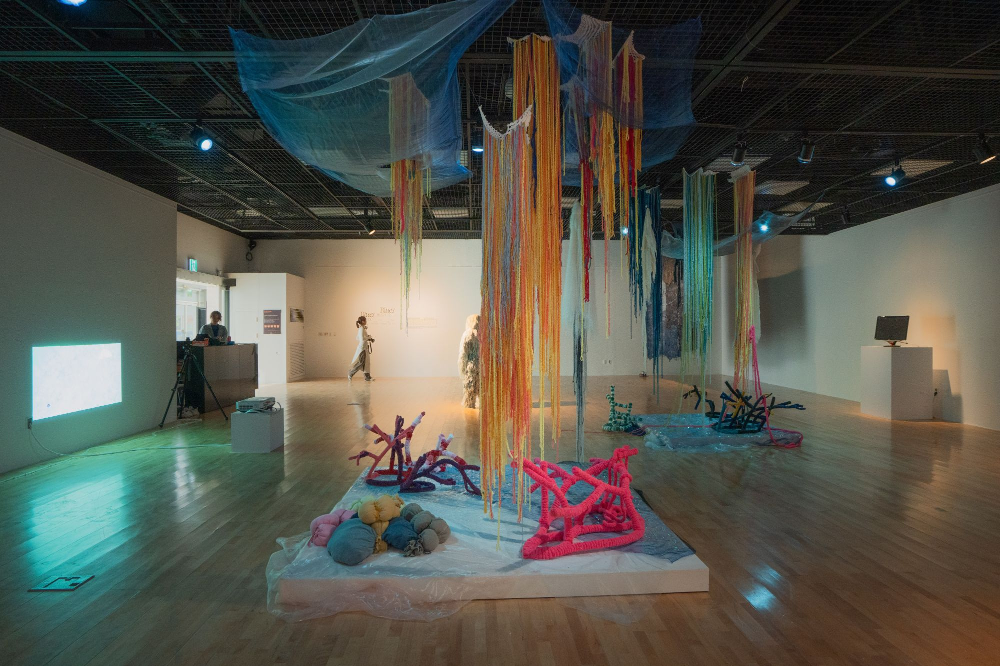
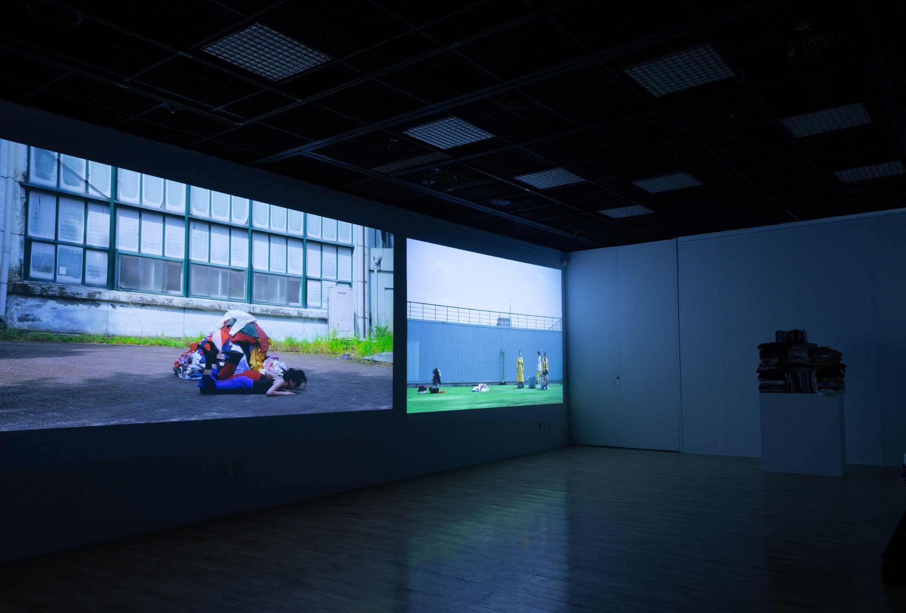

Blue's Blues was selected through the 3rd Bupyeong Emerging Curator open call organized by the Bupyeong-gu Foundation for Culture, with support worth approximately 25 million KRW. I planned and ran the exhibition as its overall curator. The work was a collaboration between choreographer Cha Minyoung and artist Choi Kyungwon.

## Curatorial statement

We turn our attention to blue: the blue of the vital sea; the blue of jeans, at once the workers' garment and a representative fashion item of the age of consumer capitalism; and the blue that portrays anxiety and melancholy. Blue is a color that shines clear and at the same time symbolizes depression. It is the representative color of the sea, and also the color of indigo dye, which causes the largest ecological problem among clothing dyes.

We judged that a strategy of overlapping the blue of the sea with the blue of jeans, an icon of contemporary fashion, to create an irony of color is the most effective artistic means of making visible the marine ecological problems of fast fashion. For this reason we name the exhibition Blue's Blues, a name in which blue is inscribed twice.

Completed through the collaboration of choreographer Cha Minyoung and artist Choi Kyungwon, the exhibition 《Blue's Blues》 conveys the ecological problems caused by clothing culture to the viewer's skin, through the waves produced by the moving body and the still body, the outer skin and the interior of the body, and the future and the traces of the body.

