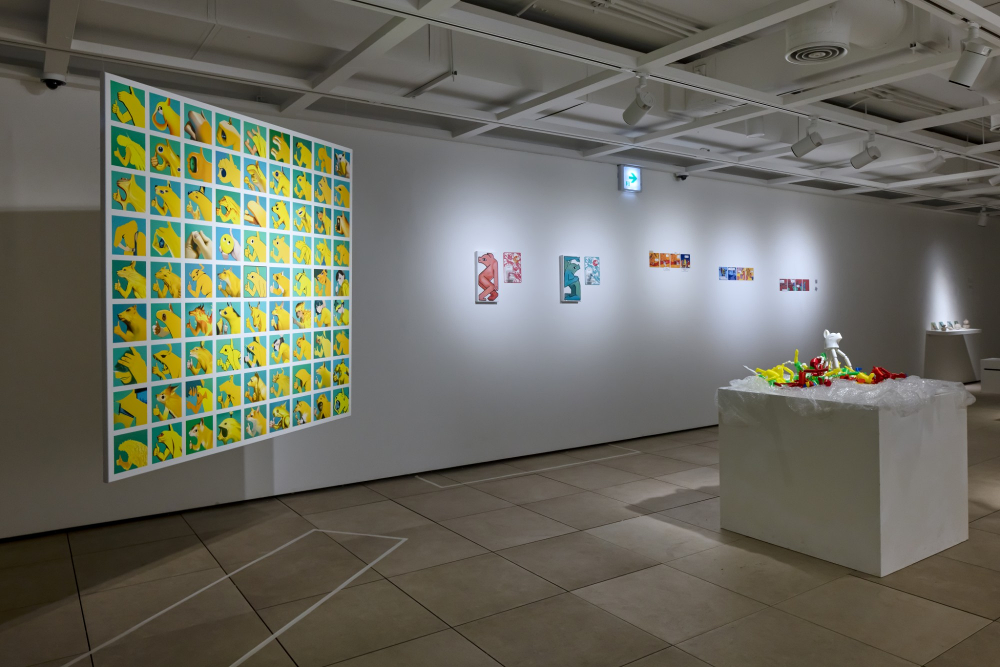

Liquid Crystal Friendship was selected through the 2023 Seoripul Youth Art Gallery visual arts exhibition-planning open call organized by the Seocho Foundation for Arts and Culture. The award provided the exhibition space and funding, and I planned and ran the exhibition as curator and also took part as an artist.

## Curatorial statement

《Liquid Crystal Friendship》 departs from the dichotomous world of optimism and pessimism about AI technology and explores the new epistemology that the present demands. Optimism that blindly trusts technology has easily tilted toward an indiscriminate nihilism about humanism, while its opposite, a technology-pessimist worship of humanity, has produced a blind fantasy of the premodern. These two positions are at once far too easy an attitude and far too comfortable a road.

As a first attempt at exploring the space between them, this project seeks to capture the "reactions" of artists working in different fields to aesthetic objects made by AI programs. The project diagnoses that to recognize AI as a "new colleague," one must begin by setting aside the debate over the humanity of artificial intelligence, and it grasps AI through the performativity of artistic labor.

Hoping for a flexible fellowship between two beings who exchange across a liquid crystal (LCD) screen, we name this project 《Liquid Crystal Friendship》. The name also carries the will to judge our relationship with AI colleagues on the basis of concrete things rather than a net of abstract theory. To call a creative AI a colleague includes anxiety about the standing of existing human artists as well as admiration for the quality of its work, and it implies an attitude of accepting all of these ambivalent feelings.

