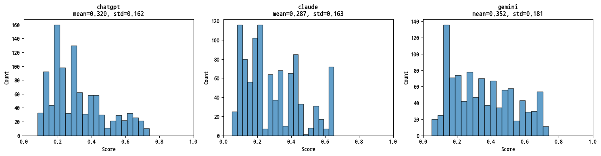

This work was part of the KISDI project "AI Transition and Global Structural Change." The question was how to estimate the potential for AI automation across a very large set of occupational records without labeling each one by hand.

I developed an LLM pipeline with retrieval-augmented generation (RAG) to score 60,000 occupational records. It used ILO ISCO-08 exposure estimates (Gmyrek et al., 2025) as reference data, and each record was scored with reference to its most similar occupations. Occupational similarity and score similarity were strongly correlated (r = 0.88).

The pipeline cut a labeling task expected to take about a month down to two days. I also maintained the structured dataset of AI exposure estimates and carried out statistical analyses of how exposure varies across occupations. The work was supervised by Dr. Aram Moon.

The project is ongoing. One line of work compares how consistently different language models score the same job across repeated runs, and how their score distributions differ.

