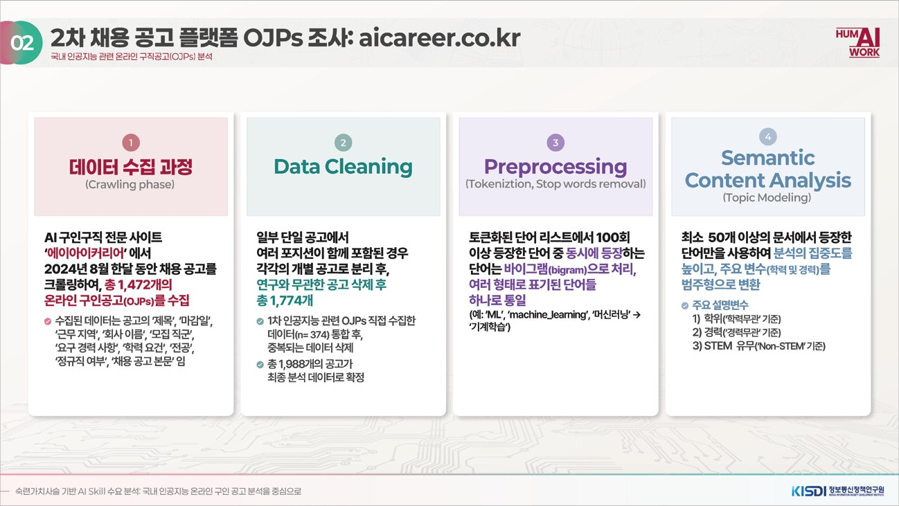
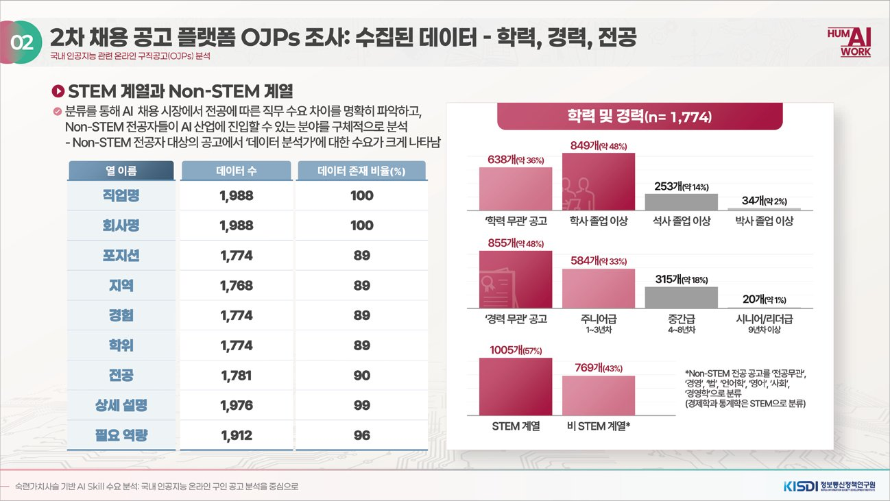
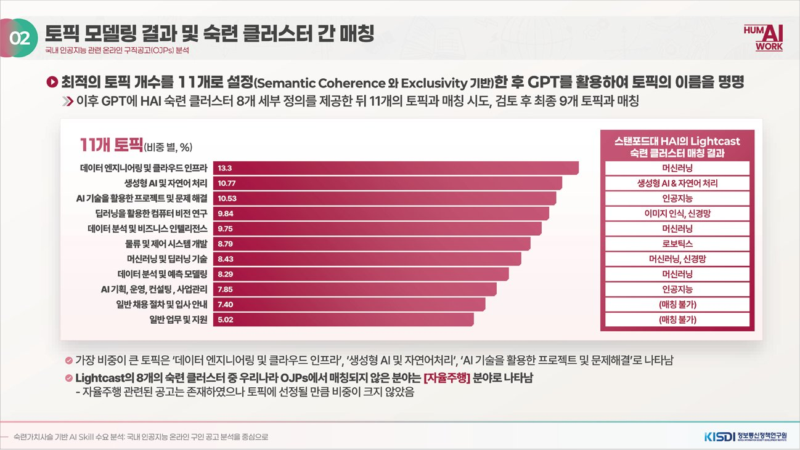
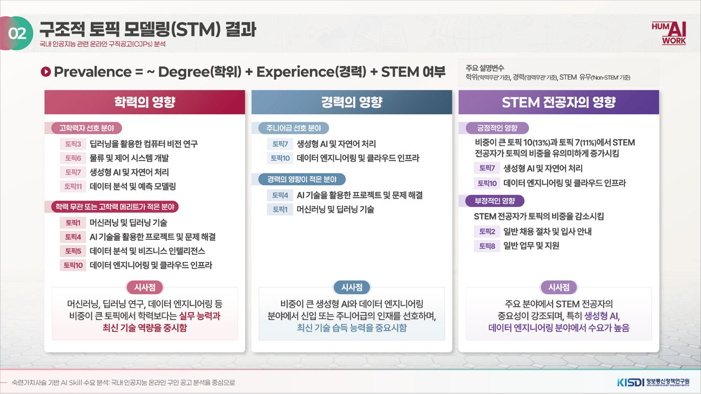
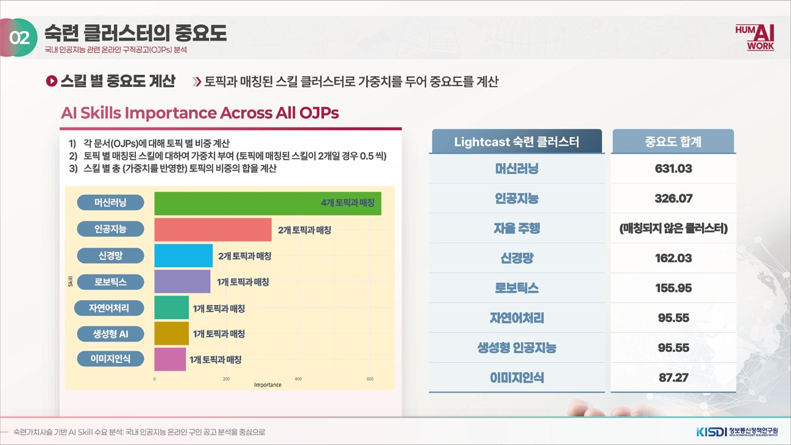

Official statistics are slow to capture the labor demand created by AI. This KISDI project, "AI Skill Demand Analysis Using a Skill Value Chain Framework," builds on a 2023 study that applied a skill value chain to AI. The chain links skill demand from industry, skill training in higher education, and expert views about future needs. The question for this part was which skills Korean employers ask for in AI-related roles, and whether Korean postings show a different pattern from the overseas studies the team reviewed.

The data came in two rounds. In July 2024 the team collected 373 AI-related postings directly from company and start-up websites (335 STEM-track, 38 non-STEM). Of these, 134 appeared on none of the three major job platforms (Saramin, JobKorea, AI Career), which led the team to treat text from any single platform as an incomplete picture of AI hiring; AI Career was chosen because it carries a high share of AI postings. In August 2024 a second round crawled 1,472 postings from the AI-specialized site aicareer.co.kr. Splitting postings that listed several positions and removing unrelated ones left 1,774 position-level records. After merging with the first round and removing duplicates, the slides report 1,988 postings in the final data. The breakdowns below use the 1,774 records.

Posting text was tokenized, stop words were removed, and frequent word pairs were merged into bigrams. The team ran word-frequency analysis (TF-IDF) by job title and structural topic modeling (STM), with degree requirement, experience requirement and STEM versus non-STEM major as covariates. The number of topics was set to 11 using semantic coherence and exclusivity, and GPT was used to name them. The topics were then matched to the eight AI skill clusters in the Lightcast taxonomy used in Stanford HAI's AI Index; nine of the eleven could be matched.

The most common job titles were machine learning engineer (269 records, 15.2%), data analyst (201, 11.3%) and data engineer (146, 8.2%). Seoul accounted for 72% of postings with a listed region (1,276 of 1,768). The largest topics were data engineering and cloud infrastructure (13.3% of text), generative AI and natural language processing (10.8%), and projects and problem solving using AI (10.5%). Weighted by topic share, machine learning had the highest skill-cluster importance (631.03), followed by artificial intelligence (326.07) and neural networks (162.03). Autonomous driving appeared in some postings but not often enough to form a topic.

The covariates separated the topics. Machine learning and deep learning, AI-based problem solving, data analysis and cloud infrastructure topics were prevalent in postings with no degree requirement, while deep learning computer vision, logistics and control systems, generative AI and prediction modeling were tied to higher-degree postings. Generative AI and cloud infrastructure topics were more common in entry-level and junior postings. Postings that asked for a STEM major had a higher share of those two topics and a lower share of general hiring and administrative text. The presentation reads this as employers giving more weight to hands-on ability and up-to-date technical skills than to degree level in the largest topics.

My role as research assistant, from July to October 2024, was to collect the job postings and run the structural topic modeling and word-frequency analysis. The presentation lists me as part of the research team. Dr. Hyunkyung Lee and Prof. Byungjun Kim supervised the project.

Dr. Lee presented the project as Presentation 3 in the session "Social Challenges for Labor-Friendly AI" at the 2024 Research Symposium on ICT-Based Solutions to Social Issues, organized under the Ministry of Science and ICT. The presentation also covered a survey of AI course syllabi at universities and the K-MOOC platform, and domestic cases of new AI education models. Those parts are not summarized here.

## Source

Lee, H. (2024). AI skill demand analysis based on the skill value chain: Focusing on online job postings for AI in Korea. Presentation 3 in *Values and social challenges of labor-friendly AI*, 2024 Research Symposium on ICT-Based Solutions to Social Issues (pp. 72–93). Korea Information Society Development Institute (KISDI). In Korean. Figures are slides from this presentation.
