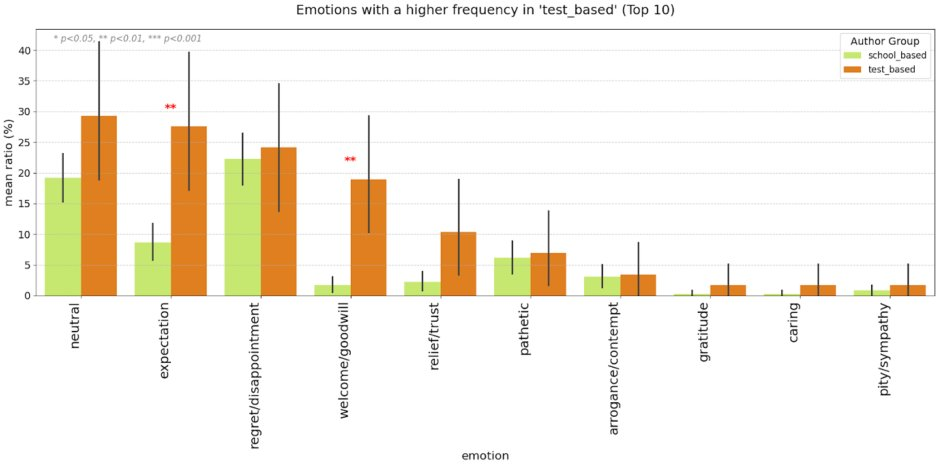
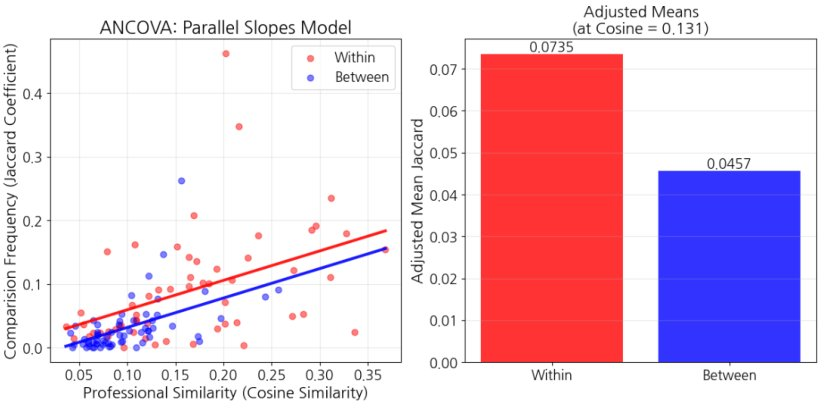
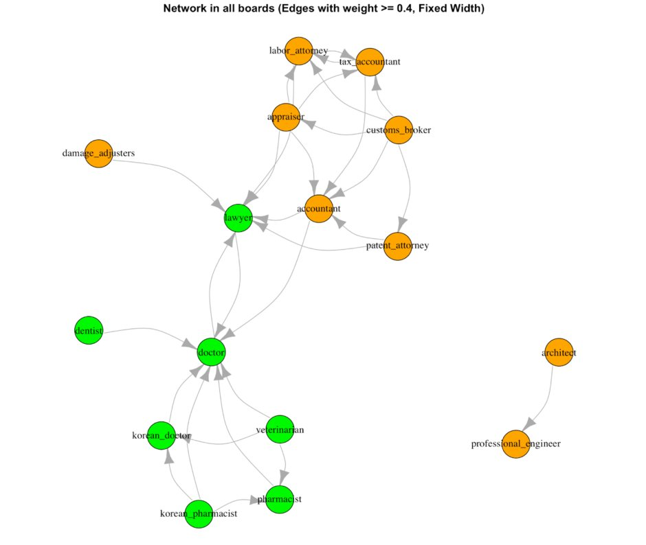
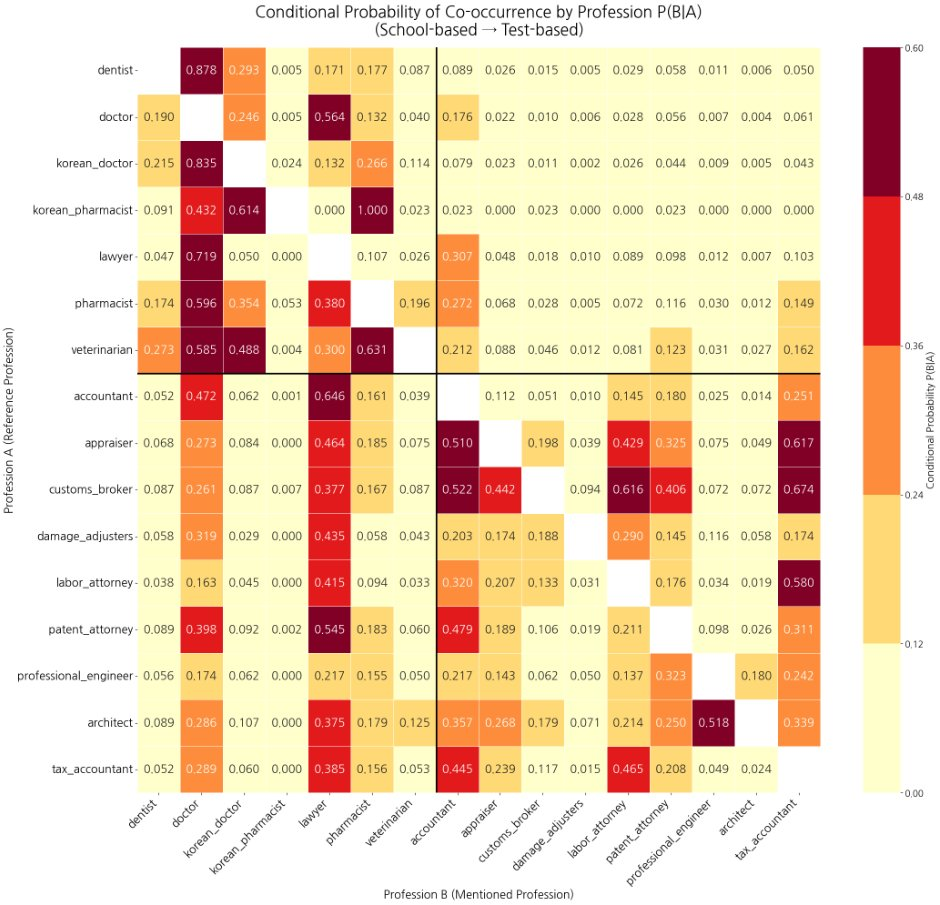
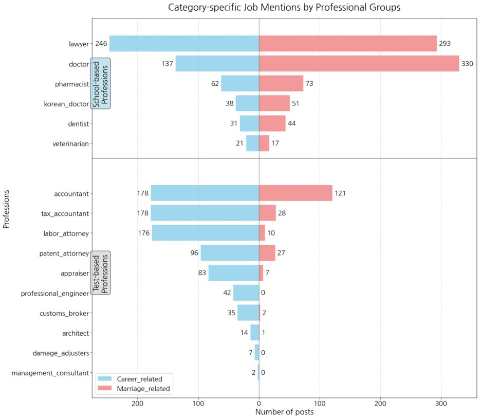
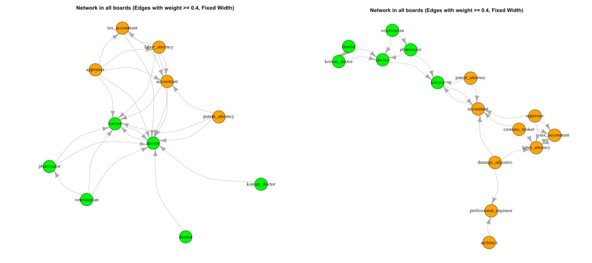

The thesis asks whether the way a person enters a profession shapes how that profession is talked about. In Korea, some professions require a specific degree (doctors, lawyers, dentists), while others can be reached through a qualifying exam alone (accountants, tax accountants, labor attorneys). The thesis calls these school-based and test-based professions. It poses three questions: whether the two pathways differ in the emotions their members express online (RQ1), whether they differ in how often professions are compared with each other (RQ2), and whether they differ in the settings where comparison happens (RQ3).

The theory draws on Abbott's account of professions as groups with exclusive jurisdiction, which treats professions as alike and leaves out differences in how people enter them. It also draws on research on elite identity, where Khan finds a sense of ease among elites and Gill finds status anxiety, and on social comparison theory, which mostly assumes that comparison follows similarity of ability. The hypotheses are that school-based professionals express more negative emotion (H1), that comparisons follow shared pathway and not only similar work (H2), and that the two groups are mentioned on different boards (H3).

The data come from Blind, an anonymous workplace community in Korea with more than 5 million registered users in 2022. Users register with a company email, and licensed professionals can verify their title. The study selected 18 professions that Korean tax and labor law treat as a special group (7 school-based, 11 test-based; architects are classed as test-based because alternative routes to the exam remain open until 2026). It searched all 153 pairs and collected posts mentioning both professions, from the first one on 21 July 2017 to 31 December 2024. A post that mentions two professions counts as a comparison. After removing duplicates and platform advertisements, 5,547 posts remained. A Claude model (Sonnet 4) was used to tell apart posts in which 의사 means "doctor" from those in which it means "intention". Descriptions of 16 of the professions were taken from the Korean Occupation Information site of the Ministry of Employment and Labor; management and technical consultants are not listed there.

The analysis has four parts. A multi-label emotion classifier built on KLUE-RoBERTa and trained on the KOTE data (44 emotions, F1 0.63) was applied to posts written by professionals, with t-tests between the two groups. Job similarity was the cosine similarity of TF-IDF vectors of the occupational descriptions, and comparison frequency was the Jaccard coefficient of each pair's posts. An ANCOVA and an OLS regression on 120 pairs tested whether sharing a pathway adds explanatory power. Directed networks were built from conditional co-mention probabilities, and a chi-square test compared mentions on career boards (work life, job change) with marriage boards (dating, married life).

On emotion, test-based professionals expressed significantly more expectation and welcome/goodwill, and school-based professionals significantly more absurdity. Doubt/distrust and annoyance were also more common among school-based authors, but not significantly. The thesis reads this as support for status anxiety among school-based professionals. On comparison, occupational similarity alone predicts how often two professions are compared (coefficient 0.548, adjusted R² 0.301). Adding whether the two share a pathway raises adjusted R² to 0.325, and the pathway term is significant (0.028, p < .05); the thesis describes this as about 8% more variance explained. At a cosine similarity of 0.131, the adjusted Jaccard coefficient is 0.0735 for same-pathway pairs and 0.0457 for mixed pairs, a difference of about 38%.

In the network, school-based and test-based professions form separate clusters. Lawyers are the main bridge. Doctors are the reference point for other medical professions, but doctors are compared almost exclusively with lawyers, and lawyers likewise only with doctors. The thesis cannot explain this pairing from job similarity or pathway. Pathway also relates to where comparison occurs (χ²(1) = 106.32, p < .001). On career boards (514 posts), test-based professions make up 55.89% of mentions and school-based 44.11%. On marriage boards (414 posts), school-based professions make up 72.94% and test-based 27.06%. Several test-based professions, such as professional engineers and damage adjusters, are not mentioned at all in marriage posts. The thesis reads school-based professions as markers of class in the marriage context, and links that visibility to the more negative emotions found for school-based professionals.

The thesis contributes to the sociology of professions by showing differences inside the group of elite professions that earlier work treated as uniform, and to social comparison research by showing that shared institutional background, not only ability, structures who is compared with whom. It also uses online community data and computational methods (sentiment classification, text similarity, networks) in place of surveys or interviews, and argues that regulation should take entry pathways into account.

The limits are stated in the thesis. Results come from online discourse and may not hold offline. Search by occupation keywords naturally favors career-related posts. The strong doctor-lawyer coupling is left unexplained, as a question for future work.

## Source

Lim, Y. (2026). *The power of entry pathways: A study of professional comparison discourse in a Korean online community* [Master's thesis, KAIST].
