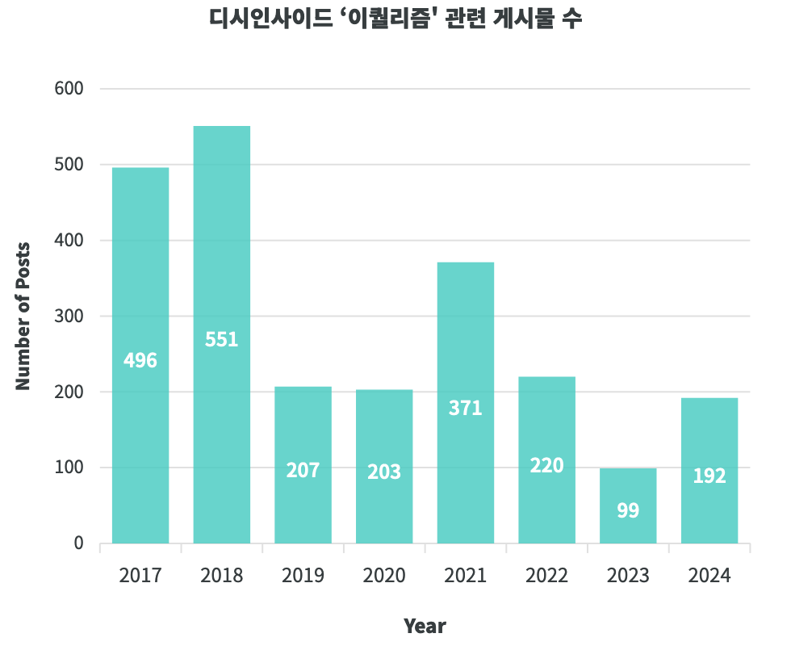
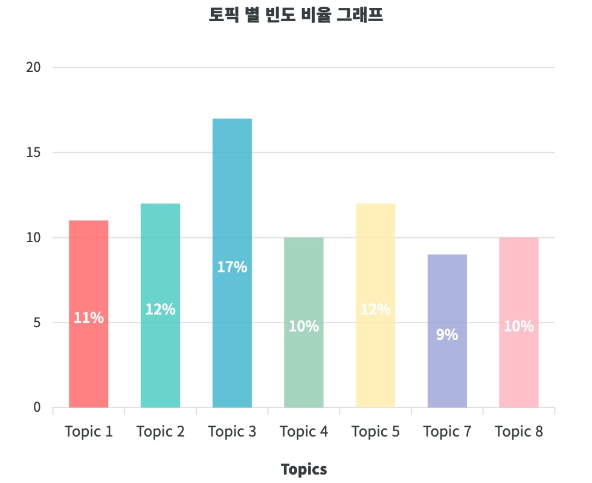
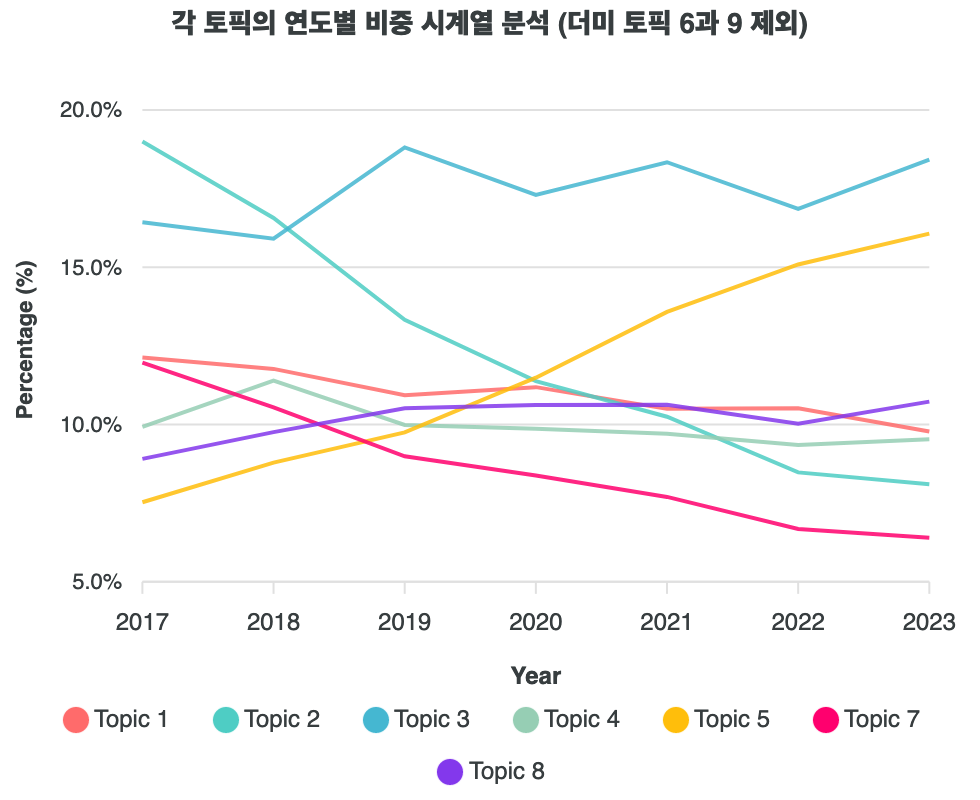
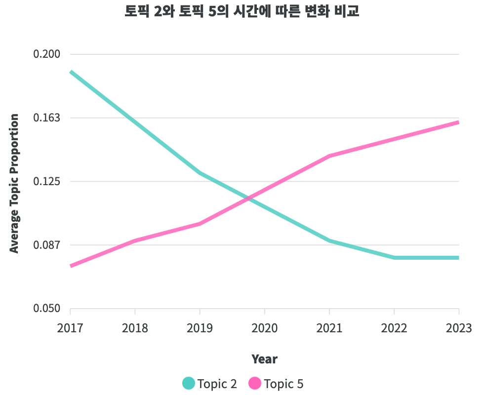

"Equalism" started circulating in Korean online communities around 2016, when a user wrote a Namuwiki entry presenting it as a serious school of thought, supported by captioned lecture images that did not contain the word. Major news outlets reported in early 2017 that the concept had been made up, and Namuwiki renamed the entry a fabrication incident. Yet in January 2024 a cable survival show still set "feminism" against "equalism" as opposing positions. The project asks what the word is actually used for once its basis has been exposed.

The data come from DCinside, a large Korean community site. The team searched all galleries for six spellings and variants of "equalism" and "equalist", then manually removed audio-equalizer posts. This gave 2,339 posts and 8,576 comments with metadata such as date, upvotes and views. Posts per year were 496 (2017), 551 (2018), 207, 203, 371 (2021), 220, 99 (2023) and 192 (2024, collected in mid-year). Because DCinside comments are often unrelated to the post and resemble posts in length, each post and each comment was treated as a separate document.

Text was tokenized with the Kiwi Korean tokenizer, with slang terms such as "equalist" and "femi" added to a custom dictionary and stop words removed by hand. The team then fitted a structural topic model (STM) with nine topics, two of which were filler topics and were left out of the later statistics. The seven remaining topics range from doubt and criticism of equalism (Topic 2), through anti-feminist and hostile statements about women (Topics 3, 4, 7) and a right-wing political topic (Topic 5), to supportive explanations of equalism as gender equality (Topic 8).

The page reads the discourse as mixed but weighted. Doubt about equalism was strong early and declined year by year, while the anti-feminist topic stayed high and the right-wing topic grew. Posts explaining equalism as a gender-equality position were a minor, steady share. The page concludes that in actual use the word works as a rhetorical cover for anti-feminism and hostility toward women, and that its users increasingly lean toward right-wing and anti-intellectual positions. Topics 2 and 5 move in nearly opposite directions (correlation of about -0.96). The page ends with two recommendations, education about the hostility behind "anti-feminism framed as equality" and media-literacy training.

The work was presented as a poster, in Korean, at the 14th Korea Internet Governance Forum in Seoul in July 2025 and received the Outstanding Poster Presentation Award. I was the first author, with J. Choi as co-author. On the project page, which the team published on 31 October 2024 under the name See-Saw, I am credited with project lead and data collection, and J. Choi with the topic modeling and analysis. Ha-neul Hong built the page.

## Interactive page

<iframe src="https://mold-on-word.github.io/seesaw/" title="seesaw — project page" loading="lazy" style="position:absolute;inset:0;width:100%;height:100%;border:0;"></iframe>

<a href="https://mold-on-word.github.io/seesaw/" target="_blank" rel="noopener">Open the project page in a new tab</a> (in Korean).
