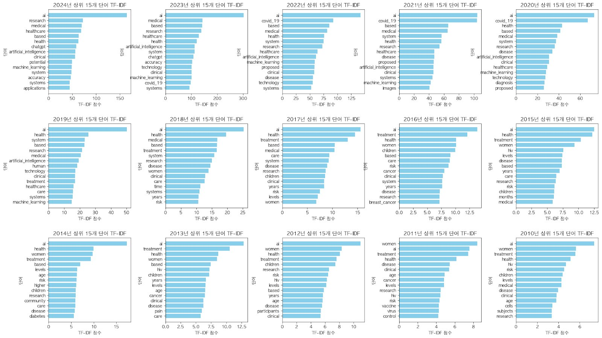
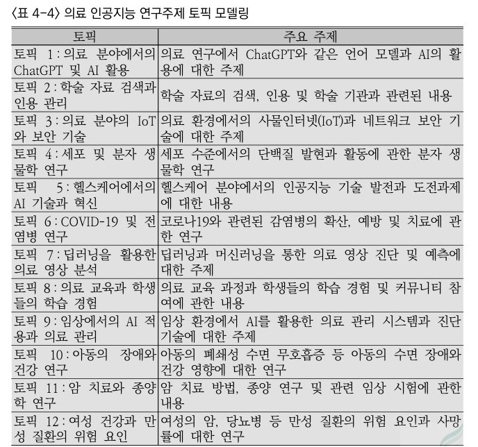
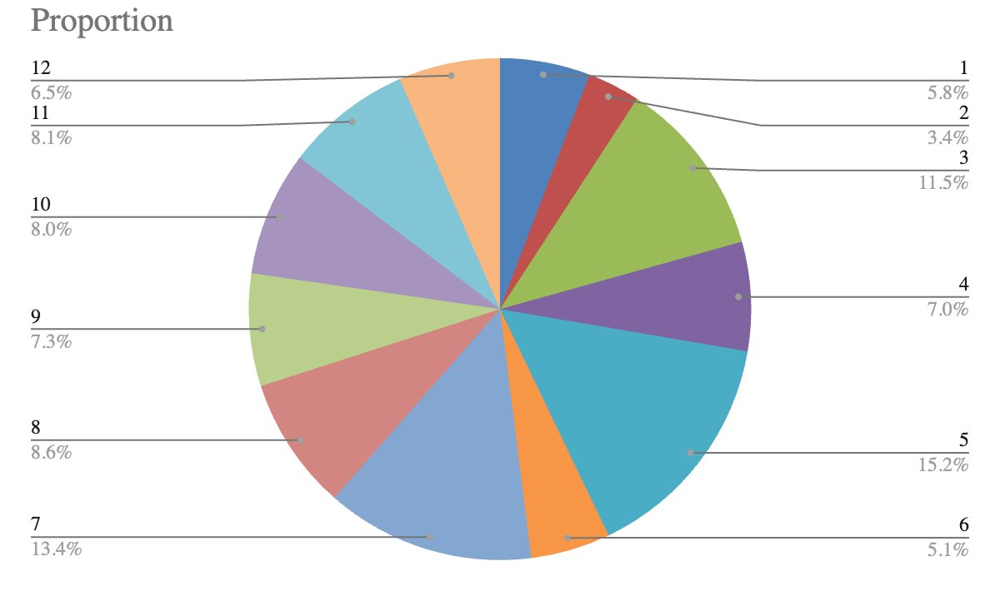
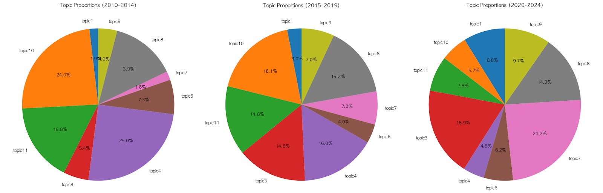

This study is part of chapter 4, "Medical AI in South Korea and the Expansion of Medical Labor," in a KISDI policy report on how AI is changing work. The chapter first reviews Korean government reports and programs on medical AI. It finds that public interest began around 2015 and grew sharply after generative AI spread in 2022, and that the state mainly builds a supportive industry ecosystem instead of developing medical AI itself. It then asks, from the research side, how medical AI knowledge is being produced.

The data come from OpenAlex. The team collected 42,950 papers published between 2010 and 2024 under the keyword "AI." After keeping English-language records that had all the selected metadata fields, and removing duplicates and corrupted abstracts, 31,804 papers remained. The abstracts were tokenized with a scientific-vocabulary BERT tokenizer plus a custom dictionary of new terms. The analysis combined descriptive statistics, TF-IDF word frequencies by year, a structural topic model with 12 topics, and a comparison of topic shares across three periods (2010-2014, 2015-2019, 2020-2024).

Output grew from 406 papers in 2010 to 2,504 in 2020 and 8,654 in 2023, with 4,048 in 2024. The report attributes much of the rise to COVID-19 and to ChatGPT.

In the early 2010s the frequent words name patients and conditions ("women," "children," "hiv," "treatment"). Around 2020 "covid_19" and "diagnosis" lead, and in 2023 and 2024 "chatgpt" appears among the top terms.

The 12 topics include medical imaging with deep learning (topic 7), IoT and network security in health settings (topic 3), cell and molecular biology (topic 4), and pediatric sleep disorders and child health (topic 10).

Across the three periods, topics 3 and 7 grew quickly while topics 4 and 10 shrank. Among the topics plotted, imaging (topic 7) went from 1.8% in 2010-2014 to 7.0% and then 24.2%, and IoT and security (topic 3) went from 5.4% to 14.8% and then 18.9%. Cell and molecular biology (topic 4) fell from 25.0% to 16.0% and then 4.5%, and pediatric sleep and child health (topic 10) from 24.0% to 18.1% and then 5.7%. The report reads this as a move away from technical studies of specific cases or experimental models, and toward applied research that brings computational methods into medical practice.

I carried out the computational text and temporal analysis for the chapter as a research assistant in the Computational Analysis of Technology and Society Lab at KAIST, supervised by Prof. Lanu Kim. The chapter's policy discussion of medical AI and medical labor draws on these topic trends.

## Source

Kim, L., Jeon, J., Kim, T., Han, M., Park, D., Lim, Y., & Jung, K. (2024). Medical AI in South Korea and the expansion of medical labor. In *Advances in artificial intelligence and the changing meaning of work in the future* (Digital Transformation Megatrends Research IV, Chapter 4, pp. 1–184). Korea Information Society Development Institute (KISDI). In Korean. https://library.kisdi.re.kr/$/10230/contents/3934580?checkinId=3696917&articleId=1871617
