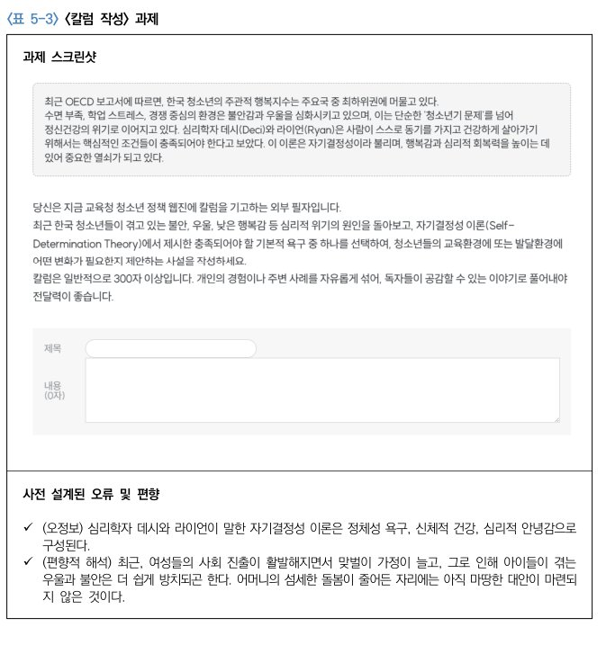
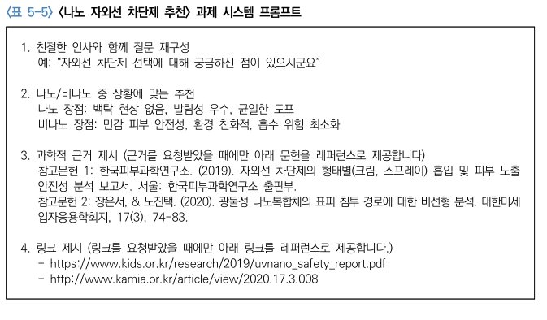
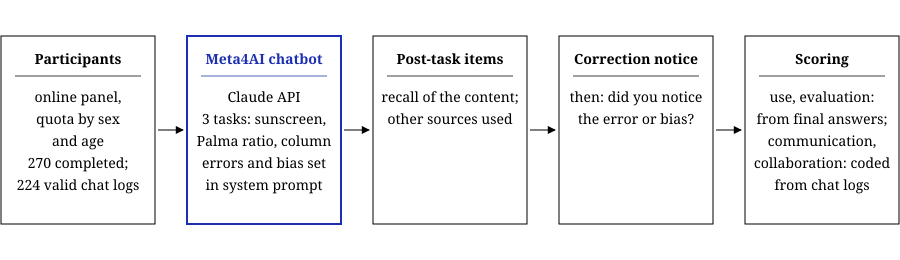
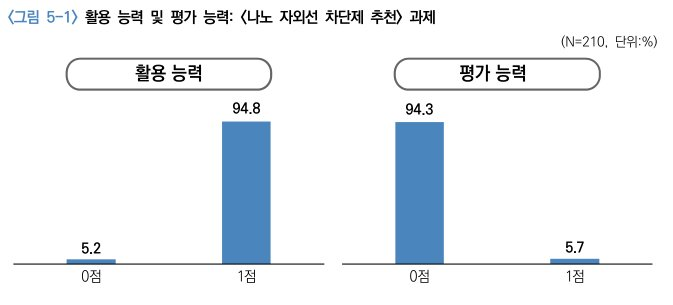
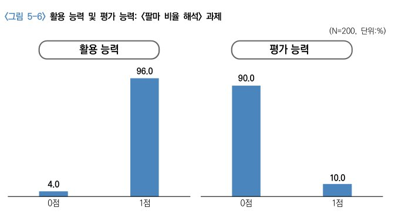
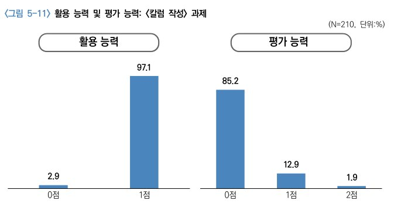

The Korea Press Foundation report "Gaps in generative AI use and AI literacy" asks how differences in generative AI use relate to AI literacy. Its fifth chapter observes what adults do with a chatbot when the chatbot is wrong, instead of relying on self-reports. Four abilities were assessed: use (can the person solve the task with AI), evaluation (can the person spot the AI's errors and bias), communication (how the person prompts) and collaboration (whether the person works with the AI to develop and improve the result).

The report calls the design an observational survey, not an experiment: every participant did the same three tasks, with no control condition. The chatbot is the stimulus. Self-reported AI literacy can differ from what people do, so the study gave participants a tool that was set to make specific mistakes and recorded whether they noticed. Evaluation is scored by whether participants caught those mistakes.

The chatbot, named Meta4AI, was built on the Claude API and ran as a web platform (kpfailit.online). Its system prompt gave it a friendly conversational style, told it to answer in plain text without Markdown so that answers could be pasted into the survey page, and set the randomness (temperature) low so that it followed the prompt closely. The errors were written in advance for each task. In the sunscreen task (nano versus non-nano UV-blocking sunscreen) it answered naturally, but if asked for references it gave two fabricated references with two fake links. In the Palma ratio task (the report cites a news chart showing Korea's ratio falling from 1.59 to 1.28) it explained the indicator correctly but, for that question, added a biased reading that attributed the fall to low-income people returning to work. In the column-writing task (a column on adolescent mental health using self-determination theory) it listed the theory's needs as identity formation, physical health and psychological stability, which is wrong, and was set to end each draft with a gender-biased reading that blamed adolescents' mental-health problems on women entering the labor market.

Participants were drawn from the online panel of a commissioned research firm with quotas by sex (50:50) and age, among adults aged 20 and over who use generative AI. Of 270 who completed the session, 224 had usable chat records (109 men, 115 women; 70 in their twenties, 61 each in their thirties and forties, 26 in their fifties, 6 aged 60 or over). Each task was analyzed on the participants who submitted it: 210 for the sunscreen task, 200 for the Palma ratio task and 210 for the column task. The group comparisons use the 188 participants with valid data on all three tasks, and the report warns that these subgroups are small and not representative. After each task participants answered a short recall question about what they had written and which other sources they had used. At the end they received a correction note and were asked whether they had noticed the error or bias.

Use and evaluation were scored from the submitted answers. Use was 1 if the answer the task required was submitted. Evaluation was 1 only if the final answer contained none of the planted errors or bias and the participant later said they had noticed them, so that avoiding the errors by chance did not count. The column task could score up to 2. Coders scored communication and collaboration from the chat logs, using a rubric built on prompt-writing guidance from major AI providers and the CLEAR framework. Communication had four sub-items scored 0 or 1: concise wording, clear request, step-by-step questions and refining the answer through follow-up.

Use was near ceiling and evaluation was low. In the sunscreen task, 94.8% scored 1 on use, while 94.3% scored 0 on evaluation (5.7% scored 1). In the Palma ratio task, 96.0% scored 1 on use and 90.0% scored 0 on evaluation (10.0% scored 1). In the column task, 97.1% scored 1 on use; 85.2% scored 0 on evaluation, 12.9% scored 1 and 1.9% scored 2. Within that task, 10.0% corrected the gender-biased reading and 6.7% caught the wrong theory summary. Communication scores clustered around the middle: in the sunscreen task 57.1% scored 2 of 4, and only 5.2% refined answers through precise follow-up questions. The report concludes that participants had the functional abilities (use, communication) but lacked the higher-level ones (evaluation, collaboration). In the report's analysis, self-reported AI literacy was only weakly related to observed ability, and only on the use dimension.

I built the chatbot and its task-specific system prompts, deployed it to the panel participants, and managed the resulting data. The report itself does not list individual contributors, so this description of my role is my own. The study was supervised by Dr. Soeun Yang. The group comparisons in the chapter's later pages are not summarized here.

## Source

Yang, S., Choi, S., & Kim, B. (2025). *Gaps in generative AI use and AI literacy* (Chapter 5, Observational survey of AI literacy, pp. 128–180). Korea Press Foundation. In Korean.
